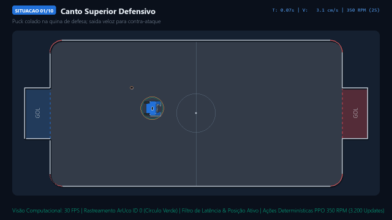

# Demonstração em Vídeo: 10 Situações Difíceis (HockeyBot · 350 RPM)

Este diretório contém a gravação contínua em **alta definição (720p HD · 1280x720 @ 30 FPS)** demonstrando o robô de hockey autônomo (RoboCore HockeyBot com motores a 350 RPM alimentados por bateria 2S Li-Ion da placa Vespa) resolvendo 10 situações difíceis consecutivas na arena.

---

## Prévia Rápida

---

## Arquivos Disponíveis

- **[10_situacoes_hockeybot_350rpm.mp4](10_situacoes_hockeybot_350rpm.mp4)**: Vídeo completo em alta definição (1280x720 @ 30 FPS, H.264/MP4) com HUD de telemetria em tempo real, cronômetro e detecção visual.
- **[10_situacoes_hockeybot_350rpm.gif](10_situacoes_hockeybot_350rpm.gif)**: Versão animada compacta para prévia direta no GitHub.

---

## As 10 Situações Demonstradas

Todas as 10 situações foram executadas com a política neural PPO congelada após **3.200 iterações** de treinamento:

| # | Situação | Descrição do Desafio | Tempo até o Gol |
| :-: | :--- | :--- | :-: |
| **01** | **Canto Superior Defensivo** | Disco colado na quina de defesa; arrancada de ré e saída para o contra-ataque | **4.53s** |
| **02** | **Canto Inferior Defensivo (180° Invertido)** | Robô de costas para a quina sul; laço de retorno e saída de zona rápida | **5.37s** |
| **03** | **Canto Superior Ofensivo (Quina Fechada)** | Disco espremido no fundo direito; puxada e chute em ângulo agudo | **2.40s** |
| **04** | **Canto Inferior Ofensivo (Bico da Trave)** | Resgate no bico da parede sul e finalização cruzada no gol | **3.77s** |
| **05** | **Centro da Quadra com Inversão Total (180°)** | Robô entre o disco e o gol; contorno perfeito sem tocar contra a própria meta | **3.57s** |
| **06** | **Parede Lateral Norte (Rente ao Alumínio)** | Disco prensado na mureta superior; descolagem e arrancada | **4.37s** |
| **07** | **Parede Lateral Sul (Rente ao Alumínio)** | Aproximação em alta velocidade pela borda inferior com corte para o centro | **6.30s** |
| **08** | **Defesa de Emergência na Boca do Gol** | Disco a centímetros da linha do gol azul; corte cirúrgico para afastar e atacar | **4.03s** |
| **09** | **Ataque Cruzado em 90° (Perpendicular)** | Abordagem transversal em alta velocidade com curva em L a 350 RPM | **5.70s** |
| **10** | **Arrancada Ponta a Ponta (Full Pitch Sprint)** | Sprint máximo de 135 cm a 350 RPM ($1.10\text{ m/s}$) com retenção e gol limpo | **2.63s** |
